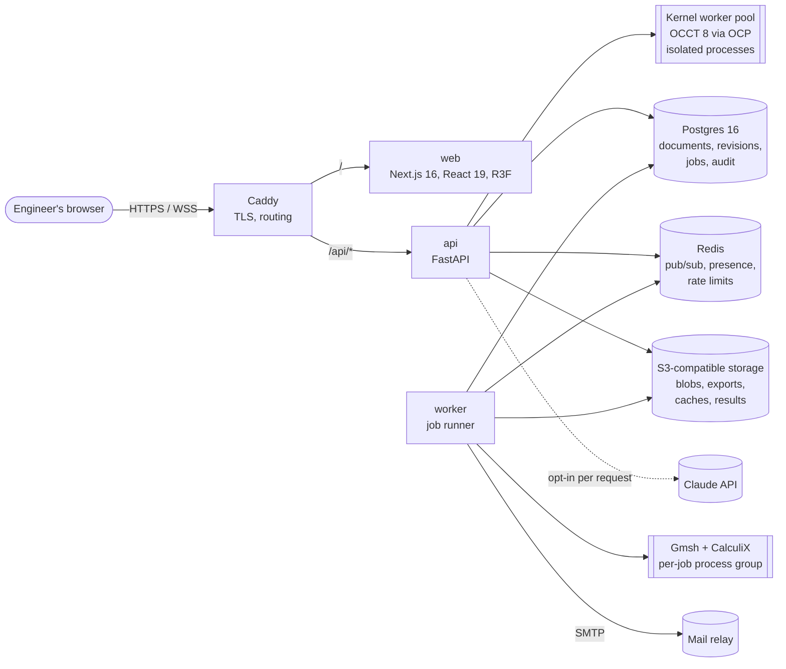
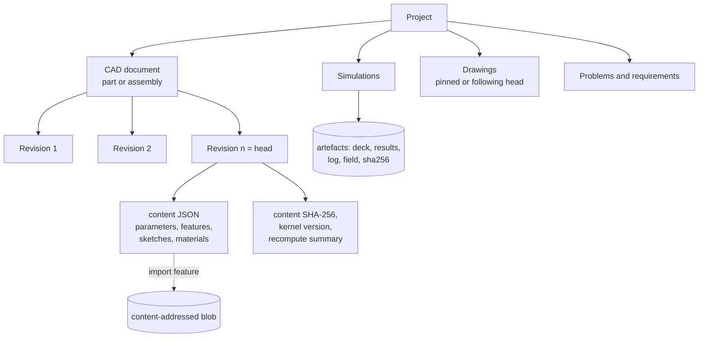
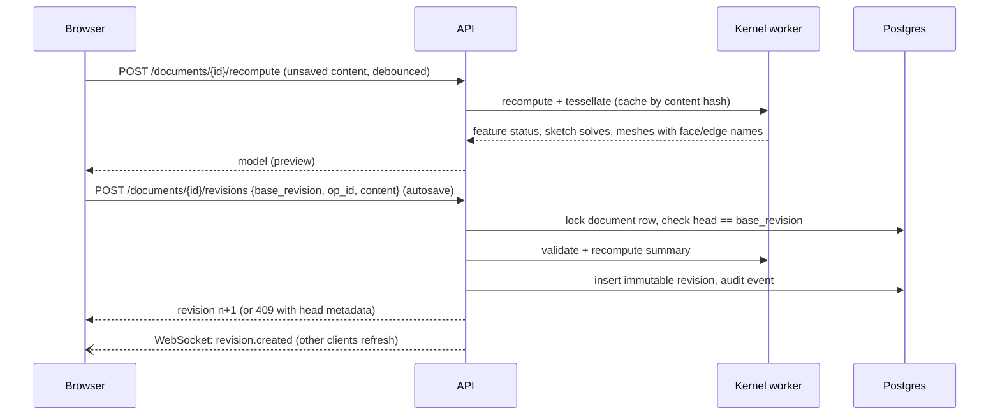
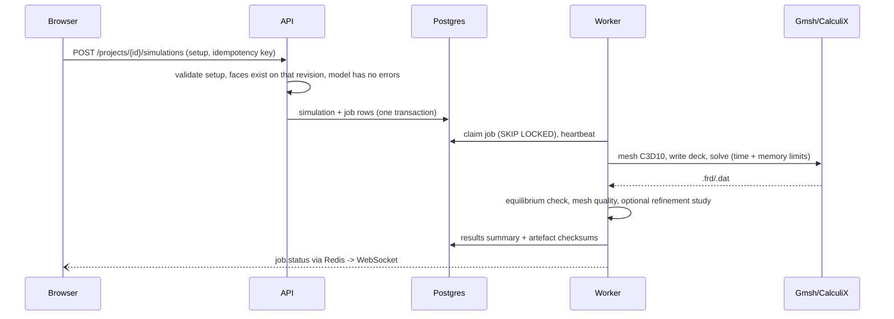

# Architecture

AutoForge is a browser application backed by a Python API that owns all engineering computation. Geometry, solving
and persistence happen on infrastructure the organisation controls; the browser renders tessellations and edits
documents.

## System context and containers

- **web**: Next.js app (pages, workbenches, sketch editor, viewers). Talks only to the same-origin `/api/v1`.
  OpenAPI-generated TypeScript types make backend route or schema changes compile errors in the web app.
- **api**: FastAPI with synchronous endpoints, SQLAlchemy 2, Alembic migrations, session cookies + CSRF, authorisation
  on every object (404 for objects the caller cannot see), audit logging, Prometheus metrics, health/readiness.
- **Kernel worker pool**: persistent processes with memory and time limits that run feature recompute, sketch
  solving, tessellation, exports, imports, measurement, interference, drawing projections. Crashes are contained and
  the worker restarted; results for unchanged content are served from a content-addressed cache.
- **worker**: claims jobs from Postgres (`SKIP LOCKED`), runs simulations in child process groups, streams progress,
  stores artefacts with checksums, recovers stale jobs, delivers the email outbox.

## Document model

Part documents are an ordered feature history (sketch, extrude, revolve, sweep, loft, hole, fillet, chamfer, shell,
boolean, patterns, mirror, datums, primitives, transform, import) with named parameters and expressions. Assemblies
hold instances (part revision pinned or following head, or catalog items), groups, mates and motion studies.

## Edit, preview and save

## Simulation

## Security boundaries

See [security.md](security.md). In short: every request is authenticated by an HttpOnly session cookie and, for
state changes, a session-bound CSRF token; object access is checked per request and denied as "not found"; uploads
are size-limited, type-checked and parsed only in kernel workers; external AI is opt-in per request and never receives
CAD files.

## Key decisions

- [ADR-0001](adr/0001-cad-kernel.md) Server-side OCCT kernel (with browser vs server benchmarks)
- [ADR-0002](adr/0002-topological-naming.md) Persistent naming
- [ADR-0003](adr/0003-revisions-and-concurrency.md) Immutable revisions and concurrency
- [ADR-0004](adr/0004-simulation-and-jobs.md) Simulation and job queue
- [ADR-0005](adr/0005-ai-assistant-boundaries.md) AI assistant boundaries
